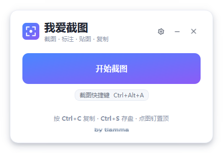

# 我爱截图

一个轻巧的 Windows 截图工具：按快捷键 → 框选 → 标注 → 复制或钉在桌面。
装好后常驻右下角托盘，随时待命。



**[下载最新版](https://github.com/zhuwm001/WinScreenshot-Utility/releases/latest)**

## 功能

- **区域截图**：拖动框选任意区域；单击直接截全屏
- **标注**：矩形、椭圆、箭头、手绘、文字，字号 12–96px 可调，支持撤销
- **钉在桌面**：把截图固定在屏幕最前，方便对照抄写，可拖动、缩放、调透明度
- **复制 / 另存**：复制到剪贴板直接粘贴，或保存为 PNG / JPG
- **能截弹窗**：下拉框、右键菜单、多级子菜单都能截到
- **多显示器**：两块屏缩放比例不同（比如笔记本 150% + 外接屏 100%）也不会截出黑块
- **开机自启**：可选，登录后静默进托盘，不打扰
- **自动更新**：新版本发布后软件自己提示，一键升级

## 下载与安装

1. 打开 [Releases](https://github.com/zhuwm001/WinScreenshot-Utility/releases/latest)，
   下载 `WoAiJieTu-Setup-v*.exe`
2. 双击安装。装到当前用户目录（`%LOCALAPPDATA%\Programs\我爱截图`），**不需要管理员权限**
3. 装完自动启动，桌面右下角出现图标

系统要求：Windows 10 / 11（64 位）。

> 安装包没有购买代码签名证书，首次运行可能出现「Windows 已保护你的电脑」提示。
> 点 **更多信息 → 仍要运行** 即可。

## 三步上手

1. 按 `Ctrl + Shift + A`（或点「开始截图」），屏幕变暗
2. 拖动鼠标框选要截的区域
3. 按 `Ctrl + C` 复制，去任何地方 `Ctrl + V` 粘贴

框选之后，下方会出现工具栏：

```
矩形  椭圆  箭头  铅笔  文字 [A- 20 A+ B]  ·  颜色  撤销  ·  图钉  另存  │  ×  复制
```

选「文字」时才会出现 `A- 20 A+ B` 这一组字号控件。最右边的蓝色按钮就是「复制」。

## 快捷键

截图时：

| 按键 | 作用 | 按键 | 作用 |
| --- | --- | --- | --- |
| `R` | 矩形 | `Ctrl + Z` | 撤销 |
| `E` | 椭圆 | `Ctrl + C` / `Enter` | 复制 |
| `A` | 箭头 | `Ctrl + S` | 另存为文件 |
| `P` | 铅笔（手绘） | `F3` | 钉在桌面 |
| `T` | 文字 | `Esc` | 取消 |
| `[` `]` / `-` `+` | 缩小 / 放大字号 | `B` | 切换粗体 |

其他：右键点遮罩 = 放弃本次截图；单击托盘图标 = 打开主界面，右键 = 菜单。

全局快捷键默认 `Ctrl + Shift + A`，可在设置里改成任意组合。

## 设置

右键托盘图标 →「设置」：

- **截图快捷键**：点一下输入框，直接按下新的组合键
- **开机启动**：登录 Windows 后自动静默运行
- **截图时隐藏本软件窗口**：截图里不会出现自己的界面
- **关闭窗口时**：隐藏到托盘，或直接退出程序
- **启动时自动检查更新**：默认开启，有新版本才提示

## 自动更新

- 启动后静默检查一次；软件常驻托盘时也会持续检查，不会因为长期不重启就错过新版本
- 两次自动检查至少间隔 6 小时，有新版本才弹窗
- 也可以右键托盘图标 →「检查更新…」随时手动查
- 点「立即更新」后自动下载、安装并重新打开，设置全部保留

更新包有作者签名校验：安装包下载完会核对签名清单和 SHA256，对不上不会安装。

## 常见问题

**截不到展开的菜单、下拉框？**
截图快捷键不要用带 `Alt` 的组合（如 `Alt+Z`）。Windows 里 `Alt` 一按下，别人的菜单就会自动收起。
改用 `Ctrl + Shift + 字母` 即可正常截取。

**两块屏，其中一块截出来是黑的？**
v1.1.0 已修复，请升级到最新版。
两块屏缩放比例不同时，遮罩会按屏幕分别显示，只能在起始的那块屏内框选。

**截图里有软件自己的窗口？**
设置里打开「截图时隐藏本软件窗口」。

**检查更新提示「TLS 初始化失败」？**
1.1.1 / 1.1.2 的安装包漏打了 OpenSSL 库，导致软件里无法访问 HTTPS。
1.1.3 起已修复，手动下载安装一次 1.1.3，之后的版本就能自动更新了。

**怎么卸载？**
开始菜单 →「卸载 我爱截图」，或 Windows 设置 → 应用。
卸载会一并清掉开机启动项，不会留下失效条目。

**配置文件在哪？**
`%APPDATA%\我爱截图\config.json`，删除后重启即恢复默认设置。

## 反馈

遇到问题或有建议，欢迎在 [Issues](https://github.com/zhuwm001/WinScreenshot-Utility/issues) 里提出，
请附上系统版本和复现步骤。

## 从源码运行

需要 Python 3.10 + PyQt5：

```bat
pip install PyQt5
python src\main.py
```

打包需要 PyInstaller 和 Inno Setup 6：`python build_exe.py` 后用 ISCC 编译 `installer.iss`。
推送 `v*` 标签时，GitHub Actions 会自动构建并发布 Release。
